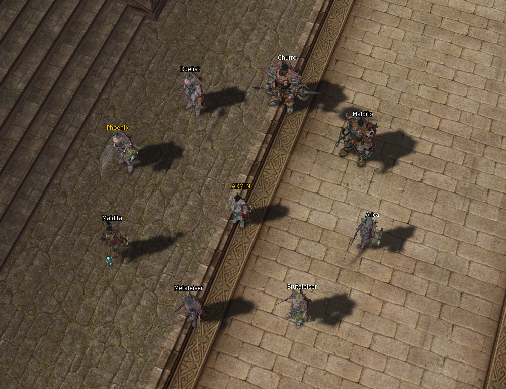
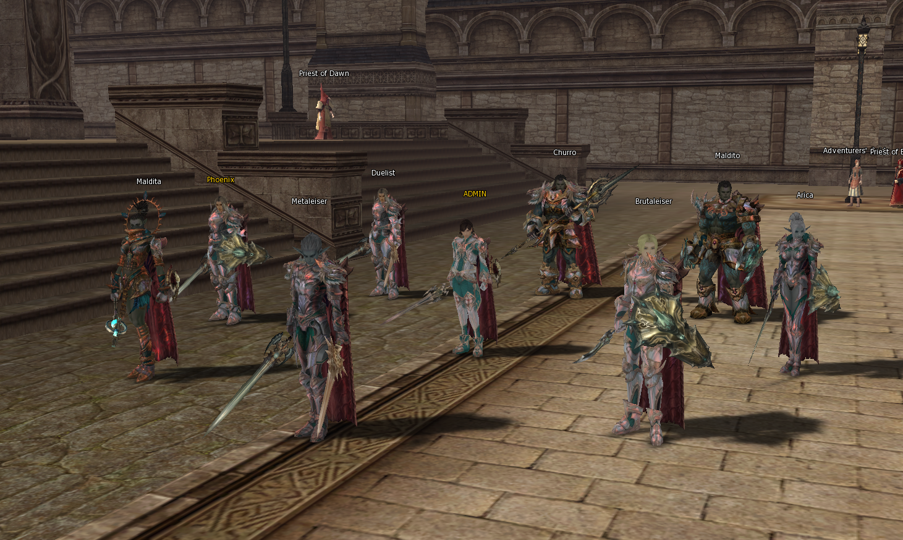
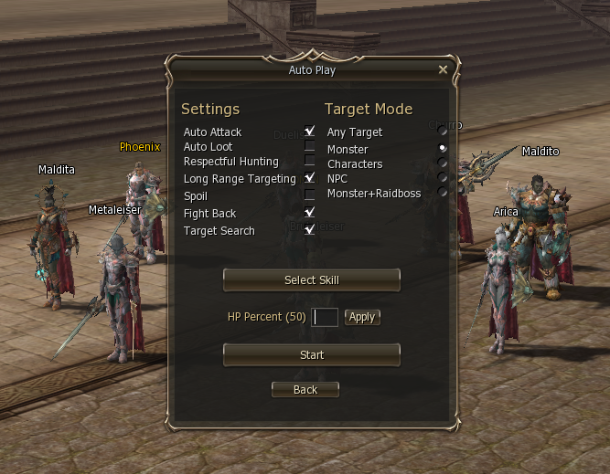

# Bot Recipe — Party server-side (.bot) para L2J Mobius H5

> Mi aporte a la comunidad L2J Mobius. Soy cocinero: esto es mi receta para jugar con tu propia party sin abrir 8 PCs.
> Convierte los otros personajes de **tu misma cuenta** en compañeros de party reales, persistentes y server-side, que te siguen, asisten y combaten.

**Requiere: L2J Mobius CT 2.6 High Five actual (JDK 27) + BellSoft Liberica 27+36**
`JDK 27 | class-major 71 | reproducible byte-a-byte | MIT`

Basado en L2J Mobius (MIT License) — https://l2jmobius.org. Bot Recipe se distribuye también bajo MIT. Ver `LICENSE`.

---

## Showcase

### Tu party completa en ciudad



ADMIN Lv.85 Cardinal (tú, conectado) + 8 bots Lv.84 de tu misma cuenta: Phoenix, Duelist, Arica, Brutaleiser, Metaleiser, Maldita, Churro, Maldito. No son NPCs. Son `Player` reales con `GameClient == null` (clientless).

### Formación desde arriba — Formation ON


Cada bot guarda su anillo alrededor tuyo. Corres, te siguen. Paras, se ordenan.

### Tu plancha de mando — ventana `.bot`



Escribes `.bot` y se abre. `START` = tu autofarm. `Autofarm / Assist / Formation` = 3 interruptores de la party. `Dismiss All` = apagar limpio. Cada fila `84 Phoenix Phoenix Knight [Login] [Config]` = slot 2..9. `[Login]` mete/saca sin logout. `[Config]` configura sin salir.

### El `.play` espejado — Auto Play Config



Es el `.play` de toda la vida (Auto Attack, Auto Loot, Target Mode, HP Percent, Select Skill) pero dentro del `.bot`. Se guarda al momento en `character_variables`.

---

## L2J Mobius .play vs Bot Recipe (cómo lo complementa)

| Lo que ya hace `.play` autofarm nativo | Lo que añade Bot Recipe `.bot` |
|---|---|
| Farmea con **1** personaje (el conectado) | Farmea con **9**: tú (Orchestrator) + 8 de tu cuenta en party (slots 2..9) |
| Cada PJ va a lo suyo | `Assist` = todos pegan al target del Party Leader. `Formation` = anillo que sigue. `Party AutoPlay` = ON/OFF global |
| Configuras solo el PJ conectado | Botón `Config` espeja el `.play` de cada bot + `Skills` por fila. Sin GM, solo misma cuenta + misma party |
| El Cardinal cura 2-3 skills, `1553/1401` monopolizan | v2.9: rotan las **9 curas** por gravedad `1011, 1015, 1027, 1217, 1218, 1219, 1401, 1402, 1553` con el mismo % HP del `.play`, respeta `targetType` nativo |
| Abortos silenciosos del motor bloquean la pasada | `castOnSupportTarget` lee el resultado real, no bloquea siguientes. Resurrección clientless no corta heals |
| Spoil/loot nativo por PJ | Switch `BOT_SPOIL` por PJ (default ON) persistido. OFF suelta cadáver en ≤700 ms |
| Cambio de PJ = logout/login | `Login` por fila: `swap` sin party / `handoff` con party + transferencia de estado |
| Instalación manual datapack + jar | `install.ps1` 8 etapas + `MANIFEST.json` SHA-256 + `verify.ps1` C1-C9 + `rollback.ps1` con backup |

**No compite, complementa:** usa el mismo motor `.play`, lo eleva a party.

---

## Instalación (solo copiar/pegar, cambias 1 cosa)

> Para alguien que nunca abrió PowerShell.

**Paso 0:** Apaga tu servidor. El instalador nunca lo apaga solo.

**Paso 1:** Abre PowerShell: tecla Windows, escribe `PowerShell`, Enter.

**Paso 2:** Copia y pega esto. Cambia SOLO lo entre comillas de la segunda línea por tu carpeta del servidor (la que tiene `game` y `libs` dentro):

```powershell
cd C:\donde-descargaste\bot_recipe
.\install.ps1 -Runtime "C:\mi-servidor-l2j"
```

**Paso 3:** Espera a que diga:

```
RESULT: PASS
```

Listo. Los backups quedan en `C:\mi-servidor-l2j\_botai-runs\<fecha>\`. No los borres, son tu reversión.

**Comandos que ya usaste (misma idea):**

```powershell
.\verify.ps1 -Runtime "C:\mi-servidor-l2j"
.\rollback.ps1 -Runtime "C:\mi-servidor-l2j"
```

El nombre público es `Bot Recipe` / comando `.bot`. El nombre interno `BOTAI-RECIPE` + carpeta `_botai-runs` se dejan quietos a propósito: así tu instalación actual sigue diciendo `ALREADY-INSTALLED` y no pide reinstalar. Puedes renombrar la carpeta de descarga a `bot_recipe` sin miedo, lo único que importa es `-Runtime`.

---

## Comandos en juego

`.bot` panel. `.bot 2..9` slot. `.bot all` activa faltantes. `.bot off` dismiss limpio. `.bot formation` / `.bot assist` / `.bot partyautoplay` toggles. `.bot status` estado real. `.bot skills <charId>` skills del bot.

Detalle: `docs/MANUAL-TECNICO.md` (fuente de verdad, 50KB) + `CHANGELOG.md`.

## Cooperar

Quiero terminarlo con ustedes: pruébenlo, suban fotos, ideas y PRs. Ver `CONTRIBUTING.md`. Roadmap: botón `[T]` To Village, scope Command Channel, persistencia entre reinicios. Licencia MIT.
